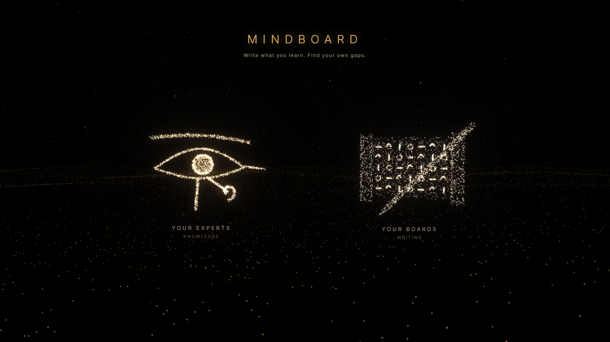

<p align="center">
  
</p>

<h1 align="center">Mindboard</h1>

<p align="center">
  <b>Write what you learn. Find your own gaps.</b><br>
  Your knowledge as a map, a local AI to deepen it, and experts made of what you wrote.
</p>

<p align="center">
  Local-first &nbsp;·&nbsp; No account &nbsp;·&nbsp; No cloud &nbsp;·&nbsp; No telemetry &nbsp;·&nbsp; MIT
</p>

<p align="center">
  <a href="#getting-started">Getting started</a> &nbsp;·&nbsp;
  <a href="#use">Use</a> &nbsp;·&nbsp;
  <a href="#ask-your-board">Ask your board</a> &nbsp;·&nbsp;
  <a href="#experts">Experts</a> &nbsp;·&nbsp;
  <a href="#backing-up">Backing up</a> &nbsp;·&nbsp;
  <a href="#commands">Commands</a>
</p>

---

AI is in every part of our lives now, and it is easy to stop learning: we ask,
get an answer, and nothing stays with us. Mindboard is for the opposite. You
write down what you learn, as a map of cards and the relationships between
them, and a local AI helps you understand it better instead of thinking for
you. It shows where your understanding is thin, so you know what to learn and
practise next.

## What you get

| | |
|---|---|
| **Boards** | A canvas of cards: text, pictures, PDFs, links and video, with named relationships and groups inside groups. A board holds ten thousand cards and stays fast. |
| **Ask your board** | A local model (Qwen3.5 9B) answers from your own cards, with citations you can click. What it adds from its own knowledge is kept apart, so you always know which ideas are yours. |
| **Find your gaps** | **What am I missing here?** is one click away. It points out where your understanding is thin and what to look at next. |
| **Experts** | Turn boards into experts you can talk to, standing as monuments of glowing sand in a night desert. A guide tells you who can answer your question, and new monuments unlock as your knowledge grows. |
| **Voice** | Talk to your experts hands-free and interrupt them, as in a conversation. Speech, listening and turn-taking all run on this computer. |
| **Yours** | Everything is copied into Mindboard's own folder and backs up into one zip. Nothing is sent anywhere. |

## Getting started

**Double-click `Mindboard.bat`** (Windows) or **`Mindboard.command`** (macOS /
Linux).

The first run sets everything up: an isolated environment inside this folder,
nothing installed system-wide. After that you get a menu:

```
  ● Mindboard 0.1.0
    3 boards · C:\Users\you\AppData\Roaming\Mindboard

    1  Open my boards         run Mindboard and open your boards
    2  Talk to my experts     run Mindboard and open the Experts
    3  Back up all boards     everything, media included, into one zip
    4  Restore from a backup  put your boards back
    5  My boards              list them here
    6  Set up the AI          the local model and the experts' voice
    7  Check the install
    8  Open the data folder
    9  Reinstall / update     get the latest version
    q  Quit

  Choose (1):
```

Press `1` and Enter for your boards, or `2` for your experts. Your browser
opens; press Enter again in that window whenever you want to stop the app.
Nothing needs saving by hand.

Opened any other way, Mindboard starts on the welcome page above: the two signs
gather out of the dust, the Eye of Horus for your experts and the scroll and
reed pen for your boards. Click one to go in.

<details>
<summary><b>If you prefer a terminal</b></summary>

```powershell
powershell -ExecutionPolicy Bypass -File .\install.ps1   # Windows
```
```bash
./install.sh                                             # macOS / Linux
```

then `.venv\Scripts\mindboard run` (or `.venv/bin/mindboard run`). Every menu
option has a command behind it; see [Commands](#commands).

</details>

## Use

The essentials:

- **New card:** press **a** (it lands where your pointer is), or double-click empty canvas.
- **Pictures, PDFs, links:** drag a file in, or paste an image or a link.
- **Connect two cards:** select one and press **c**, then click the other.
- **Group:** select two or more and press **Group** (or `Ctrl+G`); double-click a group to go inside, `Esc` to come back out.
- **Ask:** type into the chat bar at the bottom (`Ctrl+J`).
- **Everything else:** `Ctrl+K`.

The keys are also listed in the bottom-left corner of every board. Fold them
away with the **✕** and they stay folded until you ask for them again.

<details>
<summary><b>Every key and gesture</b></summary>

| | |
|---|---|
| New text node | press **a** — it lands where your pointer is — or double-click empty canvas |
| New media node | drag a file in, or paste an image or URL |
| Link or video from the web | paste any link — its cover is saved locally; click the cover to open it in your browser |
| Connect | three ways: select a node and press **c**; the **link** button in its toolbar; or click a **⊕** port. Then click the other node |
| Connect **and** create | while connecting, click empty canvas instead |
| Name a relationship | double-click the edge |
| Remove a relationship | click it, then the **✕** on its label — or `Delete` |
| Move a node | drag it — it goes exactly where you put it, and settles into line with its neighbours when it comes close |
| Move a node **with** what it is connected to | hold `Alt` and drag — the links behave like springs, so the graph swings along and settles |
| Copy / cut / paste nodes | `Ctrl+C` / `Ctrl+X` / `Ctrl+V` — relationships and group contents come too, across boards as well |
| Duplicate a node | `Ctrl+D`, or the ⧉ button in its toolbar |
| See a picture full screen | click it. Scroll to zoom, drag to move, double-click for actual size, **F** for the whole screen, `Esc` to close |
| Open a PDF | drop it on the board, then click it — it opens in your own PDF reader. What opens is a read-only copy, so to keep notes you make there, use *Save as* |
| Write on any node | double-click it — on a picture or PDF card, double-click the caption, or select the card and press `Enter` |
| Change text size | **A / A** in the toolbar, or click the number for a menu |
| Bullet or numbered list | the list buttons in the toolbar — Enter continues the list as you type |
| Recolour a node | pick a colour, then one of the three tones: bar, tinted, or solid |
| The node toolbar | click a node to open it. Hovering shows only the ⊕ ports, so a toolbar never sits over the card you were aiming at |
| Export a picture of the board | `Ctrl+E`, or the image button in the corner |
| Group nodes | select two or more — a bar appears above them with **Group** — or `Ctrl+G` |
| Put a node into an existing group | drag it onto the group; the group lights up as you cross it |
| Take a node back out | open the group, then the **↑** button in the node's toolbar |
| Ungroup | `Ctrl+Shift+G` |
| Enter / leave a meta-node | double-click / `Esc` |
| Tidy the current level | `Ctrl+L` |
| Undo / redo | `Ctrl+Z` / `Ctrl+Shift+Z` |
| Everything else | `Ctrl+K` |

</details>

### Where your things are kept

Everything you put on a board (a video you upload, a picture you drag in, the
cover of a link you paste) is **copied into Mindboard's own folder**. Nothing
points back at the file you dragged from, so you can move or delete the original
and the board is unaffected, and a backup carries the whole of it.

```
mindboard where          # prints the folder
```

On Windows it is `%APPDATA%\Mindboard`, on macOS
`~/Library/Application Support/Mindboard`, and each board is its own folder
inside it: `board.db` plus an `assets` folder of the files it shows.

Beside them, an `opened` folder holds the read-only copies handed to your PDF
reader. They are only copies: `mindboard gc` clears them, and nothing is lost if
you delete the folder.

## Ask your board

Ask your board runs **Qwen3.5 9B on this computer**, through its own llama.cpp,
reading pictures as well as text. It relies on nothing else. Setting it up is a
one-time download; after that, asking a board never uses the internet.

### Setting it up

Menu option **6** (*Set up the AI*), or from a terminal:

```
mindboard ai install      # says what it found, what it will download, and asks first
mindboard ai check        # loads the model, asks it something, shows it a picture
mindboard ai status       # what is installed, and where
```

It picks the version that fits your graphics card whole, because a model that
fits answers several times faster than one that spills over:

| Size | Model | Download | For |
|---|---|---|---|
| full | Qwen3.5 9B | 10.4 GB | a 12 GB graphics card or more, or a Mac with 24 GB or more |
| compact | Qwen3.5 9B, compact | 6.6 GB | an 8 GB card, or a 16 GB Mac |
| light | Qwen3.5 4B | 3.4 GB | any computer, graphics card or not |

It tells you what it found and what it picked before downloading anything;
`--model <size>` chooses another.

Every file is pinned (exact address, size and SHA-256) and checked as it
arrives; anything that does not match is deleted, never used. An interrupted
download carries on where it stopped. It all lives in `.llm/` in this folder,
not among your boards, so backups stay small.

An NVIDIA card gets the CUDA build, other cards the Vulkan build, a Mac with
Apple silicon the Metal build, and a computer without a card the processor
build. The model loads when first asked, unloads after 20 minutes without
questions, and always stops with Mindboard.

### Asking on the canvas

Type into the **chat bar** at the bottom of the board (`Ctrl+J` goes there) and
press Enter; the conversation opens above it. To ask about particular cards,
press the **bubble** in a card's toolbar, or select several and press **Ask** on
the bar above them; a group brings everything inside it.

- **Answers stream in.** Every card an answer draws on is a chip you can click
  to go to it, even inside a group. Anything the model adds from its own
  knowledge sits apart under **Beyond your board**.
- **What am I missing here?** is one click away. **Think deeper** lets the
  model think first, and **Stop** stops it.
- **Next question:** under each answer it offers one question to ask next;
  click it to ask.
- **Expand** (in the conversation's header) gives the conversation the whole
  screen. There, **Explain more** answers from the conversation and its cards,
  a fuller explanation with examples, without searching the board.
- **Add to board** under each answer drafts a card from it and proposes the
  card it belongs with; edit it and press **Add** (`Ctrl+Z` undoes it).

Cards an answer cited stay in the conversation for the questions after it. The
conversation lasts while the board is open in that tab, so save what matters as
a card.

Or from a terminal:

```
mindboard ai ask --board "Sensor siting" --card "Sensors" --card "Site sketch" "Where should the lidar go?"
mindboard ai ask --board "Sensor siting" --all "What am I missing?"
```

Cards you add yourself are used exactly (a group brings everything inside it),
with their pictures and the relationships between them. Whatever it takes from
your cards it cites; whatever it adds from its own knowledge comes after
**Beyond your board:**, uncited. Citations of cards that were not in context are
removed. Add `--think` to let it think first (slower, deeper).

<details>
<summary><b>How it finds the right cards</b></summary>

With nothing added, the board is **searched**, never sent whole, so asking
works the same on a board of fifty cards or ten thousand. Mindboard finds the
cards your question is about by meaning, and by keywords with stemming (so
*evaluating* finds *evaluation*), titles counting double and small typos
forgiven; put words in "quotes" to require them exactly. A second small model
then reads the best of them closely, each together with what it is linked to,
and relevance spreads from the best along your relationships and groups, so a
card that is only a title, or only reachable through your links, is still
found. The best ones go to the model with an outline of the board's groups.
The panel says how many cards it used. A follow-up is searched together with
the question before it.

The two search models are small (0.6 GB each, downloaded with the rest). The
main model always comes first on the graphics card: the search models use it
while there is room, and give it back when the main model needs it.

A board learns the meaning of its cards in the background, when you open it
and a moment after each change, so asking never waits for it, however big the
board. Until it is done, cards are still found by their words and links, and
the panel says how far it has got. Pictures are described in words once, while
the model is loaded anyway, so a screenshot is found by what is written in it.
The descriptions are kept with the search index, not in your cards.

To measure how well search finds the right cards, write a test set (questions
about a board, each with the cards a good search returns) into
`<data folder>/evals/<board name>.json`, and run:

```
mindboard ai eval --board "RAG Deep Knowledge" --detail
```

</details>

**If answers are slow:** the panel says when the graphics card has less free
memory than the model needs; free up the card for full speed. On a laptop, a
quiet or battery-saving power mode can hold the card to a fraction of its speed.

## Experts

**Experts** on the board list (or the Eye on the welcome page) opens a night
desert where your experts stand as monuments of glowing sand. An expert is a
name, a sentence about what it knows, and the boards it draws on: it answers
from those boards, in its own voice, and every card it cites opens on its
board.

- **Not sure who to ask?** Type the question in the overview and the guide says
  who can help, and why.
- **Talk to one:** click its monument or its name to go inside.
- **Stop it any time:** the ■ button, or `Esc`, stops the answer and the voice.
  Scroll up to read while it writes; the conversation stays where you put it.
- **Add to board:** under every answer. The model drafts a card from it; you
  choose which of the expert's boards it goes on and which card it links to,
  then press **Add**. It is marked as made by AI.
- **Open a cited card and come back:** the conversation is still there.
- **They grow with you:** a monument's size is how much its boards hold. New
  shapes unlock as your library grows: the ankh from the start, then the
  obelisk, the pyramid, the step pyramid and the temple gate.

### Voice

Experts speak their answers in a natural voice (Kokoro), and you can talk to
them hands-free: press the microphone once and just speak. A voice detector
(**Silero VAD**) tells your voice from background sounds, and your words
appear in the bar as you say them. When you pause, **Smart Turn** listens to
how your voice ended and tells whether you have finished or are only taking a
breath - and if you carry on a moment later, it is still the same question.
Speak while the expert is answering and it stops to listen, as in a
conversation. Everything runs on this computer, and the audio is not kept.

```
mindboard ai voice        # one-time, about 520 MB: speaking, listening, turn-taking
```

In the chat bar, the **1×** chip sets how fast the expert speaks, and the
speaker button turns speaking off. The voice is optional: its pronunciation
step uses espeak-ng, which is GPL-3.0.

## Backing up

Menu options **3** and **4**, or from a terminal:

```
mindboard backup                     # every board, media included, into one zip
mindboard restore backup.zip         # put them all back
```

Backups made from the menu land in a `backups` folder next to this file.

A backup is an ordinary zip you can open and inspect: a `manifest.json` plus one
`.mindboard` bundle per board. Restoring keeps each board's identity, so
restoring the same backup twice does **not** duplicate your library: boards
already present are left alone. Use `--replace` to overwrite them from the
backup, or `--copy` to bring them in alongside what you have.

The app takes backups too: **Back up all** on the board list, or `Ctrl+K` →
*Back up every board*. Dropping a backup zip into **Import** restores all of it.

## Commands

```
mindboard menu                       # the screen the launcher opens
mindboard run [--port 7788] [--host 127.0.0.1] [--data-dir PATH] [--no-open]
mindboard install [--with-demo]
mindboard backup [-o FILE]
mindboard restore FILE [--replace | --copy]

mindboard boards
mindboard new "Title" [-d "description"]
mindboard export <board-id> -o board.mindboard
mindboard import board.mindboard
mindboard delete <board-id>

mindboard doctor        # check the install
mindboard gc            # drop media no node references
mindboard where         # print the data directory

mindboard ai install    # set up Ask your board (one-time download)
mindboard ai check      # test the local model
mindboard ai ask --board B --card C "question"   # ask about chosen cards
mindboard ai eval --board B                      # measure search against a test set
mindboard ai voice      # set up the experts' voice
mindboard ai status
```

## Developing

```bash
./install.sh
.venv/bin/mindboard run --dev         # backend on :7788
cd web && npm install && npm run dev  # interface on :5173, proxying /api
```

`./build.sh` writes the built interface into `src/mindboard/web/`, which the
wheel ships. `.venv/bin/python -m pytest tests` runs the suite.

Design and architecture: [DESIGN.md](DESIGN.md).

## License

MIT.
